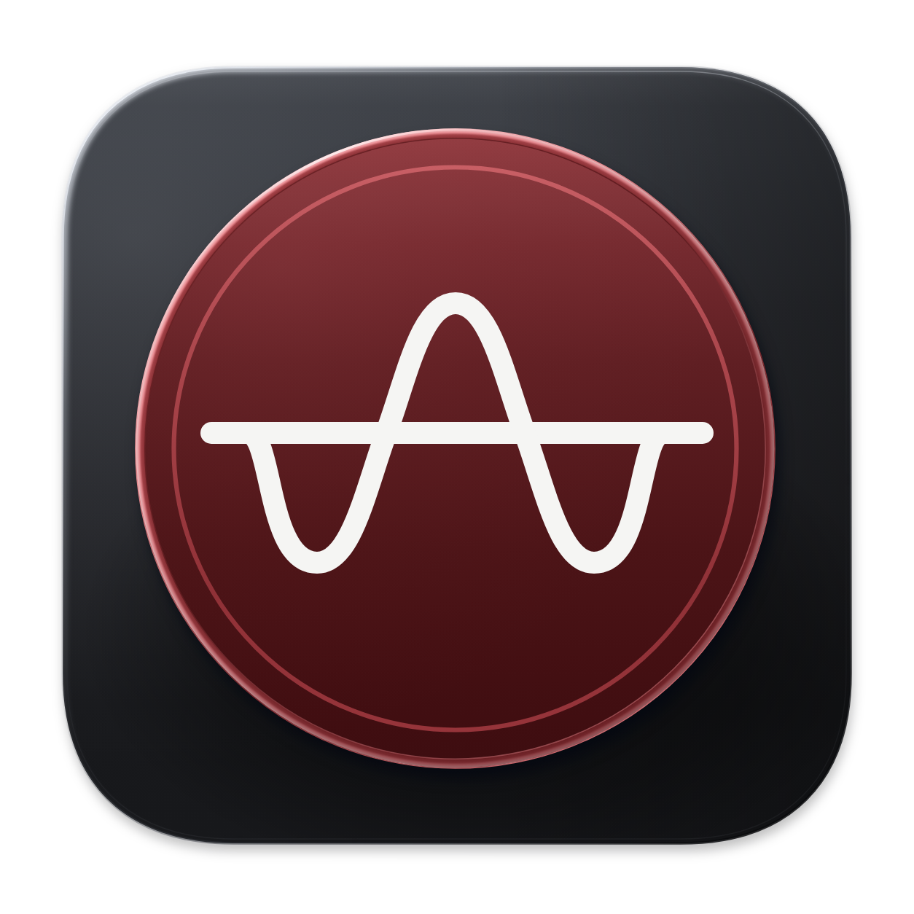

<p align="center">
  
</p>

# URAW Recorder

Windows 原生录音与音频监看工具。

URAW Recorder 可以录制输入设备，也可以侦听系统或指定应用的播放音频。界面显示电平、VU 表、频谱和单音音高。

## 功能

- 使用 WASAPI 共享或独占模式录音，选择输入设备和受设备支持的输入格式。
- 录制 32 位浮点 WAV、24 位 FLAC 或 LAME VBR MP3。WAV 必要时使用 RF64；FLAC 和 MP3 可调整压缩设置。
- 显示 RMS、峰值、VU、频谱和音高。音高检测适用于单音，参考音高为 A4 = 440 Hz。
- 导入麦克风校准文件，对输入信号应用幅频校准。校准和软件增益作用于仪表及录音。
- 侦听整机或指定应用的播放音频，不生成录音文件。整机可选择进程混音或所选输出设备的回环。
- 暂停后继续写入同一文件，或丢弃当前录音。文件名包含日期和时间，已有文件不会被覆盖。

## 运行环境

项目面向 Windows x64，当前开发和验证环境为 Windows 11。录音需要可用的输入设备；侦听需要相应的播放源。设备驱动对独占模式和输入格式的支持可能不同。

## 使用

1. 从 [GitHub Releases](https://github.com/hakanasora/URAW-Recorder/releases/latest) 下载单文件 EXE，双击运行，无需另装 .NET 或 FFmpeg。首次启动会提取运行文件。源码构建的目录版可通过 `Start.cmd` 启动，移动时需保留整个发布目录。
2. 在设置的输入页选择设备、录制模式和输入格式。在文件页选择保存路径和录制格式。保存路径留空时，文件保存在用户音乐目录的 `Portable Recorder` 文件夹中。
3. 点击 **录制**。录音时可以暂停、继续或停止；暂停时可以丢弃本次录音。
4. 要观察播放音频，在顶部切换到 **侦听**，然后选择整机或应用来源。

启动和待机时使用共享监看。设备明确不支持 RAW 共享监看时，程序会询问是否在本次运行中允许普通共享监看；这不代表允许使用普通非 RAW 模式录制。

FLAC 保留输入采样率和 1 至 8 个声道。MP3 仅支持单声道或立体声及其兼容采样率，程序不会自动混音或重采样。压缩格式中超过满刻度的样本会削波并提示；需要保留浮点超限值时使用 WAV。压缩录音在收尾时需要额外磁盘空间，请等待保存完成。详见 [压缩录音](docs/compressed-recording.md)。

侦听的进程混音和输出回环取流范围不同。驱动效果、空间音效和受保护内容的表现取决于系统与音频链路，详见 [侦听设计与验证](docs/designs/listening-native-capture.md)。

## 从源码构建

安装 .NET SDK 10.0.402。构建脚本也接受 `PORTABLE_RECORDER_DOTNET` 环境变量指定的 `dotnet.exe` 路径。

```powershell
./tools/build.ps1
```

发布单文件 EXE 时运行以下命令。

```powershell
./tools/build.ps1 -SingleFile
```

单文件输出为 `artifacts/singlefile/URAW Recorder.exe`，首次启动自动提取运行依赖。构建脚本会准备并打包 FFmpeg、字体、WinUI 资源和许可证。

脚本发布 Windows x64 自包含程序至 `artifacts/current-preview`。普通构建使用仓库内固定版本的精简 FFmpeg，并校验文件摘要，无需另行下载编码器。编码测试另用完整 FFmpeg 解码验证，首次检查可能下载该验证工具。精简编码器的来源与重建方法见 [构建说明](docs/minimal-ffmpeg.md)。运行音频检查：

```powershell
./tools/check-audio.ps1
```

检查使用合成样本和测试适配器，不能代替实际设备和驱动的验证。

## 第三方组件

项目使用 Windows App SDK、Win2D、NAudio、NWaves、Pitchy 的 C# 适配，以及 FFmpeg 和 LAME。来源、版本和许可文本见 [第三方说明](third_party/README.md)。发布目录包含相关许可文件。

FFmpeg 构建的再分发有额外源码和构建材料要求。对外分发二进制文件前，参阅 [FFmpeg 说明](third_party/ffmpeg/README.md)。

## 许可证

本项目采用 [MIT 许可证](LICENSE)。第三方组件的许可另见 [第三方说明](third_party/README.md)。
