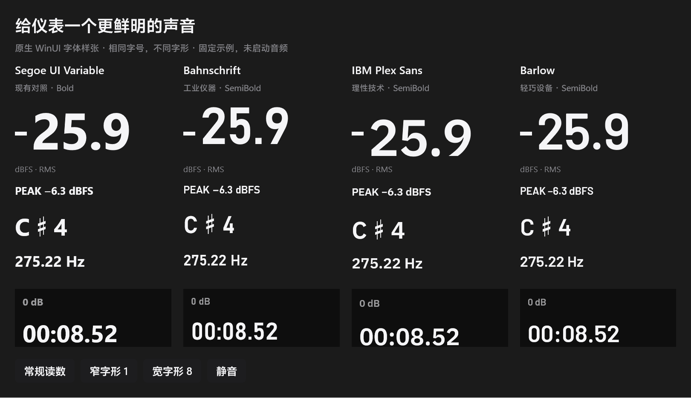

# 数字字体探索 · 第一轮

本轮遵循 design-taste-frontend 的组件研究路径：沿用现有产品方向，不抽取新的页面风格，不改变录音主界面布局、灰黑材质、琥珀 VU 或金色曲线。目标是给快速更新的测量数字找到稳定、清楚、稍有硬件性格的字形。没有最终替换正式字体。

## 原生对照

双击根目录 `TypeStudy.cmd`，或运行：

```powershell
artifacts/native-preview/PortableRecorder.Desktop.exe --type-study
```

这是独立 WinUI 样张窗口，不创建 AudioEngine，不占麦克风，不写录音偏好。四列依次为当前 Segoe UI Variable Bold、Bahnschrift SemiBold、IBM Plex Sans SemiBold、Barlow SemiBold。单位和说明文字仍保留现有 UI 字体；负号仍用原型约定的短线。字体研究窗口的 `C♯4` 是整体字形比较，不代替正式音高组件的上下标排版。

电平为 69 DIP、PEAK 14 DIP、Hz 20 DIP、增益 13 DIP、时钟 32 DIP。Segoe 对照使用 Bold，其余先尝试 SemiBold；因此这是候选配置比较，不是同字重实验。各字体的字面率、基线和留白不同，相同字号不等于相同可见高度。若选定后正式应用，还需要分别调整负号中心、音名升号／八度、时钟基线及阅读块垂直重心。

样张按钮切换常规读数、111、888、静音；不将这些示例伪装成实时音频。



[111 比较](type-study-1.png) · [888 与红色 PEAK 比较](type-study-2.png)

## 选择意见

- **首选 Bahnschrift SemiBold**：DIN 血统与便携录音仪器的性格吻合，窄一些的数字给主读数与时钟更多留白。1 的底脚、开阔的小数点、偏直立的轮廓比当前默认 UI 字体更有辨识度。代价是气质稍硬，原生垂直度量也不同，需要光学校正。可先将它用于电平／时钟／Hz／增益数值，中文和普通菜单继续现有字体。
- **第二选择 IBM Plex Sans SemiBold**：技术气质中保留温度，1 的斜切与底脚、2 的曲线更有个性。数字横向较宽，且垂直度量明显偏低；正式应用时不能只换 FontFamily，须重新检查布局。PEAK 小字表现清楚。
- **第三选择 Barlow SemiBold**：笔画平直但轮廓略柔和，整体最轻巧，较接近现有界面，属于稳妥小改。必须启用 tabular figures，否则默认比例数字会随读数变化改变宽度。
- **保留 Segoe 对照**：当前粗体阅读快，但整体更像系统应用；可以作为其他三款都不合适时的保守方案。

不引入七段数码管、装饰性的等宽编程字体或苹果专用字体来制造仪器感。本轮更看重读数的字形，而非增加装饰。

## 数字稳定性

字体二进制检查：IBM Plex Sans 默认数字 advance 一致；Barlow 默认不一致，但有 `tnum` 替换；Bahnschrift 也支持 `tnum`。所有样张显式设置 WinUI `Typography.NumeralAlignment=Tabular`。

本机原生 TextBlock 实测，字号 69、对应字重、无额外字距：

| 字体 | `111.1` 宽 DIP | `888.8` 宽 DIP |
|---|---:|---:|
| Segoe UI Variable | 178 | 178 |
| Bahnschrift | 163 | 163 |
| IBM Plex Sans | 187 | 187 |
| Barlow | 168 | 168 |

这里验证的是排版宽度稳定，不是全部字符或全部 DPI 的认证。升号等缺失字形仍可能使用系统回退字体，需要在最终音高组件里单独检查。

## 来源与许可

- [Microsoft Bahnschrift 说明](https://learn.microsoft.com/en-us/typography/font-list/bahnschrift)：Windows 系统字体，本仓库不分发该字体文件。
- [IBM Plex 官方说明](https://www.ibm.com/design/language/typography/typeface/)；样张文件来自 [Google Fonts IBM Plex Sans](https://github.com/google/fonts/tree/main/ofl/ibmplexsans)，保留原始可变字体，固定随仓库分发的副本，SIL OFL 1.1。
- [Barlow 项目](https://github.com/jpt/barlow)；SemiBold 文件来自 [Google Fonts Barlow](https://github.com/google/fonts/tree/main/ofl/barlow)，SIL OFL 1.1。

文件和完整许可证位于 `src/PortableRecorder.Desktop/Assets/TypeStudy/`，发布时随样张资源复制。没有安装系统字体；没有在线字体加载或 JavaScript 运行时。字体加载自本地 appx 资源 URI。

## 本轮检查与自评

WinUI Release 发布成功。已启动原生样张窗，导出并逐张查看常规／111／888 三张图片，修正首轮窗口 DPI 尺寸造成的裁切，以及第二轮各字体自然行高导致的底栏位置不齐。最终样张各列底栏对齐，内容无横向裁切。固定主读数字号后，Bahnschrift 的紧凑与 Plex 的宽厚都能看出来；候选的垂直字面差异仍是接下来选型的重要依据。

此对象是原生 C# 组件，浏览器 HTML inspector 不适用；未运行浏览器校验，也没有伪报网页分数。没有修改音频路径，本轮未重复全套 DSP 测试。正式主界面默认字体及 Ctrl+Alt+T 的既有行为均保持原样。
